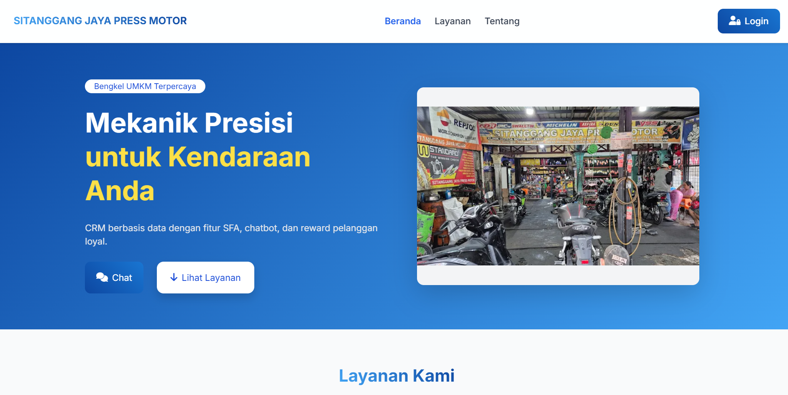
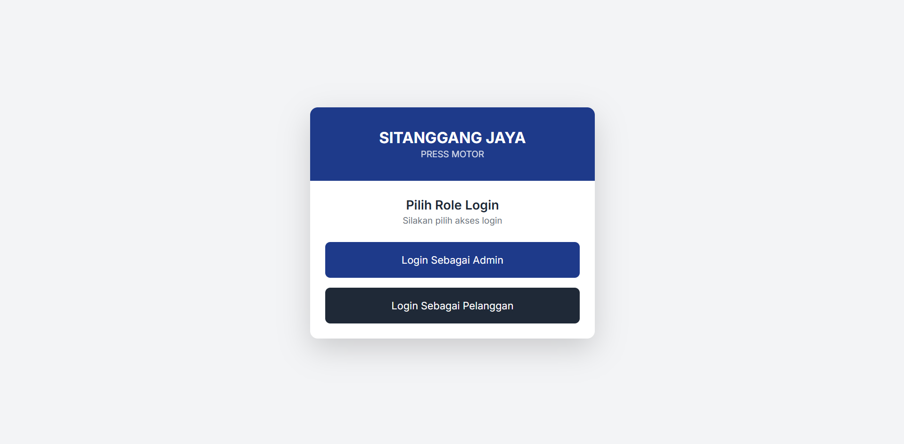
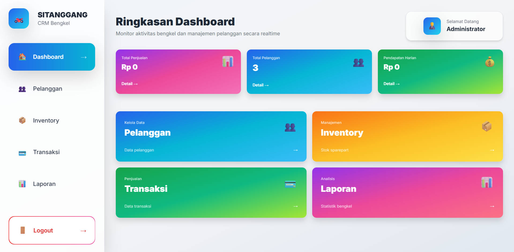

# SITANGGANG JAYA PRESS MOTOR CRM - Design Plan

To access admin page. Example http://localhost/crm_bengkel/

## Tampilan Aplikasi

## 1. Frontend Pelanggan
*   **Homepage:** A modern landing page showcasing workshop services (press motor, service, spareparts) with a clear Call-to-Action for customers to login and check their history.
*   **Customer Login:** A simple login form using Name and Phone Number, styled with Bootstrap 5.
*   **Customer Dashboard:** A personalized view for the customer showing their service history, total services done, and status of current work.

## 2. Admin Panel (Backend)
*   **Admin Login:** A secure login page located at `/admin`.
*   **Admin Dashboard:** Overview with statistics (total sales, total customers) and charts for sales trends and best-selling products.
*   **Data Pelanggan:** A CRUD interface to manage customer information with a clear "Add Customer" button.
*   **Data Produk:** Management for spareparts and services (CRUD).
*   **Transaksi:** A streamlined checkout/service entry flow where admins can select a customer, add products/services, and see an automated total.
*   **Laporan:** Detailed reports with graphics and a list of loyal customers.

## Design Aesthetic
*   **Colors:** Blue and White.
*   **Layout:** Sidebar navigation for the admin panel, responsive design for all screens.
*   **Framework:** Built with Bootstrap 5 compatibility in mind for easy PHP/MySQL integration.
